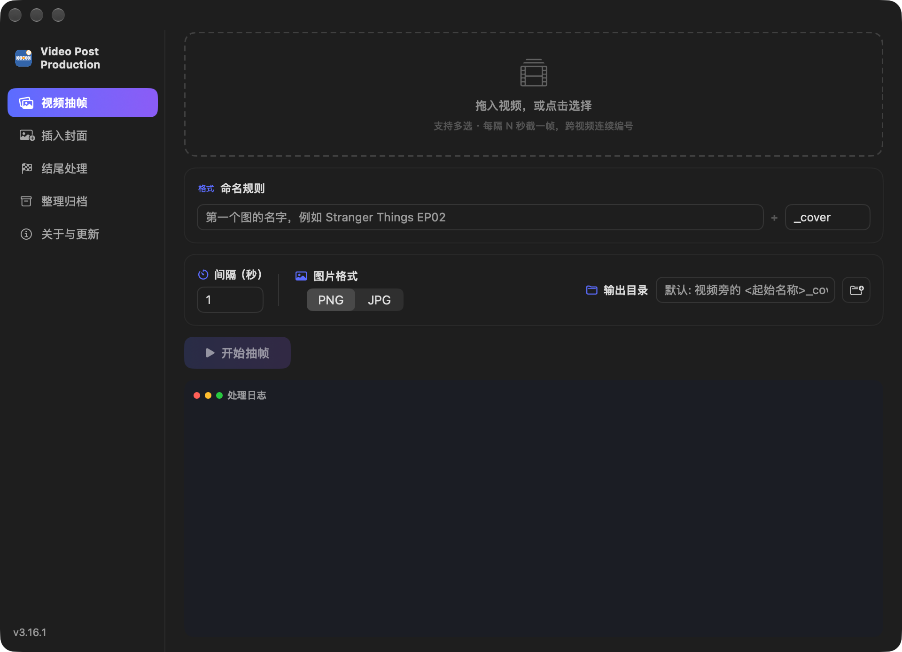
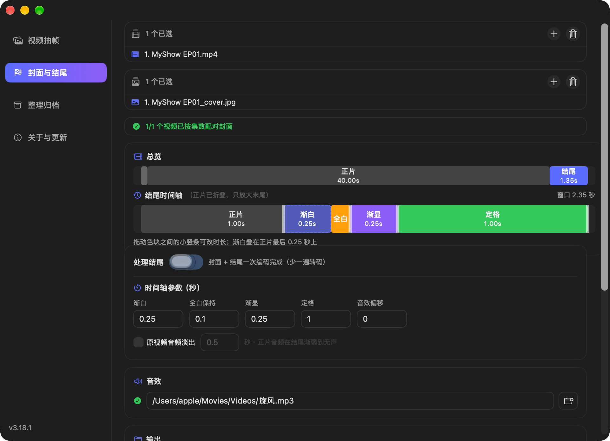
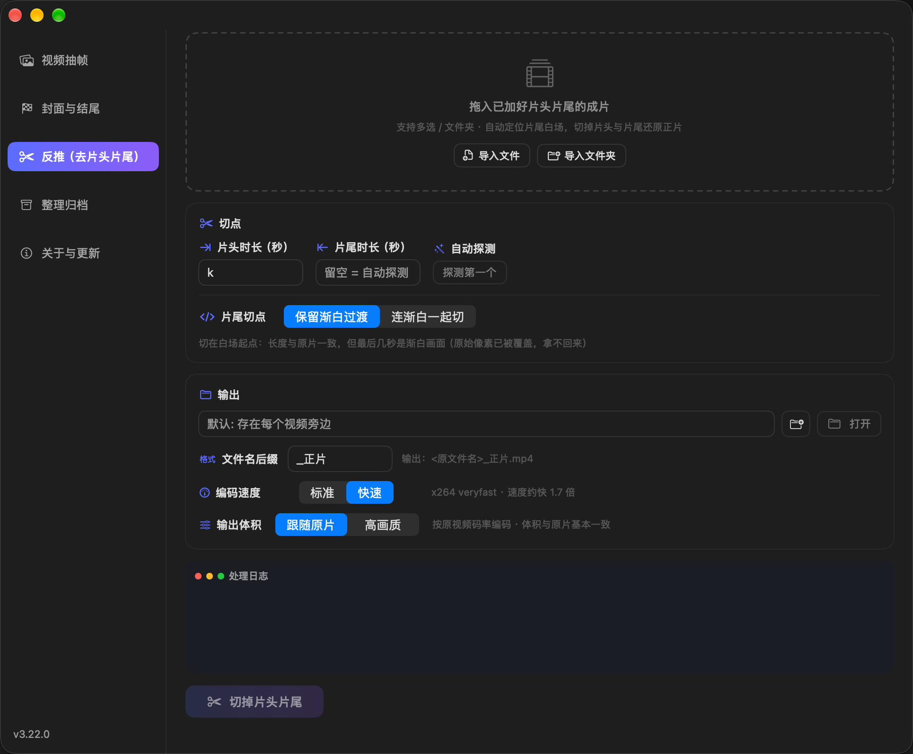
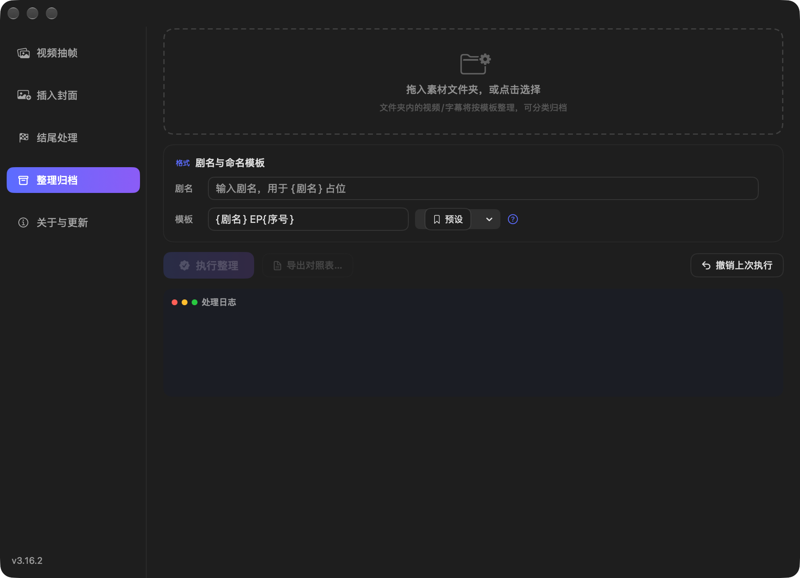
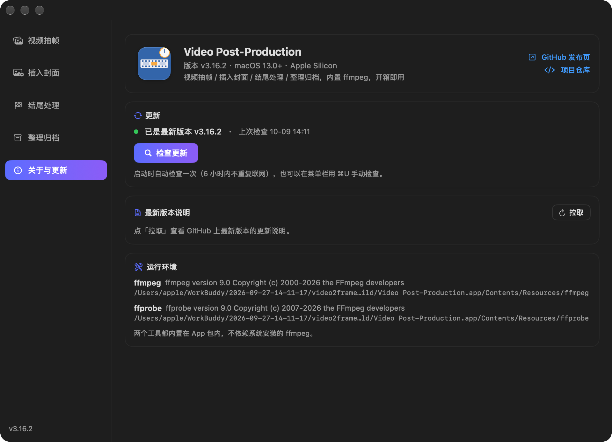

# Video Post-Production

一款为短剧/批量视频后期处理打造的 macOS 原生工具（SwiftUI + 内置 ffmpeg），把「抽帧、封面与结尾、反推去片头片尾、整理归档」几件事装进一个 App。

  


最新版本安装包见 [Releases](https://github.com/keyisi/video-post-production/releases/latest)：`.dmg`（推荐，拖进「应用程序」）或 `.zip`，内置 ffmpeg，无需额外安装。

版本规则 `x.y.z`：新功能/大改动进 `y`（`z` 归 0，如 3.15.0），修 bug 或小调整只进 `z`（如 3.14.1）。

最近一次发布：**v3.22.0**（2026-10-20）—— 封面 1% 等比缩放、原片归档（成片原地替换）、反推去片头片尾、文件与文件夹双入口导入、「仅片尾」模式。完整历史见 [Releases 更新日志](https://github.com/keyisi/Video-post-production/releases)。

## 功能板块

五个板块常驻在窗口里，**左侧边栏切换** —— 切走再切回，已选文件、参数、日志、处理进度都还在。

### 0. 自动更新检查

- 启动时自动检查 GitHub Releases（6 小时内不重复联网），发现新版本可**一键下载安装并自动重启**（无需手动去网页下载）；联网走四级兜底「API 直连 → API 走代理 → `releases.atom` 直连 → atom 走代理」，绕开 MITM 代理的 TLS 拦截与 API 限流
- 发现新版本：右上角出现「新版本 vX.Y.Z」提示 + 弹窗（含更新说明与安装包信息），一键打开 GitHub 下载页；可「跳过此版本」
- 手动检查：点右上角版本号，或菜单栏「检查更新…」（⌘U）

### 1. 视频抽帧



- 拖入视频（或文件夹），按设定间隔抽取帧图
- 支持自定义输出目录、PNG/JPG 格式（JPG 可调质量）、起始名称与后缀

### 2. 封面与结尾（时间线）



把「插封面」和「做结尾」合成一个板块，用**时间线**直接看到成片结构：

- **总览行**：封面（锁死 1 帧，当首帧海报用）→ 正片（按真实时长折叠）→ 结尾
- **结尾时间轴**：正片尾部放大铺满，**渐白以半透明叠在正片最后几秒上**，其后依次 全白 → 渐显 → 定格
- **可拖拽**：拖动色块间的小竖条直接改时长，与下方数字输入框双向同步，松手自动对齐到 0.05 秒；拖到上限会停住并提示
- 封面按集数自动配对（EP21 ↔ 封面21，上层文件夹名不参与匹配）
- **封面缩放**：100% 完整显示（不足处补黑边）；往上调 101%、102%… 逐 1% 放大，超出画面的部分居中裁掉，调到「铺满」档刚好不留黑边；缩小则黑边更多。滑块粗调 + 「−/＋」1% 微调，一键「铺满」「复位」，两条执行路径（只插封面 / 封面+结尾一次编码）行为一致
- 「处理」三选一：**仅封面**（输出到「加封面」文件夹、文件名不变）／**仅片尾**（只加片尾完全不插封面，封面列表保留）／**封面+片尾**（一次编码完成，少一遍转码，输出到「加结尾」文件夹）
- **导入更省事**：视频与封面都支持「导入文件」+「导入文件夹」双入口（拖拽同样认文件夹，只扫第一层）；多次导入是**追加**不会互相清掉；封面可以单独从封面文件夹一次全收
- **原片归档（可选）**：勾选「原片移入『原片』文件夹，成片原地替换」后不再另存新文件夹——原片挪进视频旁的「原片」夹，成片用**原文件名**写回原位置，播放器/后续流程里的路径不变；同名原片自动加 `-1`、`-2` 去重，绝不覆盖；编码失败或中途停止会自动把原片搬回原位、清掉半成品（CLI 对应 `--archive`）
- 🎵 音效（可加偏移）／🔊 原视频音频淡出／⚡ 编码速度／📦 输出体积（跟随原片或高质量）
- ⏱ 实时进度 + 每集用时，处理中可随时停止（已完成保留，半成品清理）

### 3. 反推（去片头片尾）



- 把**已经加好片头片尾的成片**反向处理：切掉片头的封面帧和片尾的白场/定格段，还原出正片
- **自动定位片尾**：扫描逐帧亮度（signalstats，3 分钟 1080p 约零点几秒），找到片尾白场的起点——不需要记得当初的参数；「探测第一个」自动回填片尾时长，也可以留空让每个视频各自探测
- **两种切点**：
  - **保留渐白过渡**：切在白场起点，长度与原片完全一致（但最后几秒是渐白画面——渐白是叠在正片最后几秒上的，原始像素已被覆盖，拿不回来）
  - **连渐白一起切**：切在渐白之前，画面完全干净，但比原片短一个渐白时长
- 片头时长默认按 1 帧自动算（本 App 加封面固定插 1 帧），其他工具加的片头可手动填秒数
- 切点不在关键帧上，采用 seek + 重编码保证帧级精确；输出 `<原文件名>_正片.mp4`
- CLI：`--strip <视频...> [--detect] [--drop-fade] [--head 秒] [--tail 秒] [-o 目录]`

### 4. 整理归档



- **支持文件夹与文件两种导入**：整个文件夹按内部结构整理；也可以只选几个文件（归档位置按所选文件所在文件夹）
- 按模板批量重命名：`{剧名} EP{序号}` 等，支持 `{剧名} {序号} {日期} {时间} {原名} {扩展名}` 占位符
- **普通视频原地改名**（不再生成「成片」文件夹）；带 `(N)` 副本标记的归到「纯净」，字幕文件归到「字幕」
- 执行前预览改名对照、重复/冲突检测、执行后一键撤销、导出 CSV 对照表
- 模板不含 `{扩展名}` 时自动补全后缀，防止输出丢扩展名

### 5. 关于与更新



- 应用信息（版本、系统要求）+ GitHub 发布页 / 项目仓库直链
- 更新状态一目了然：当前版本、上次检查时间、手动「检查更新」、发现新版本时可直接下载或跳过
- 「最新版本说明」：一键拉取 GitHub 上最新 Release 的更新日志
- 运行环境自检：内置 ffmpeg / ffprobe 的版本与路径

## 运行要求

- macOS 13.0 及以上（Apple Silicon）
- **无需安装 ffmpeg** —— 已内置到 App 包内（静态编译版 ffmpeg 9.0 + ffprobe）

## 使用方式

- 直接双击仓库里的 `build/Video Post-Production.app`
- 或下载发布包：解压后把 App 拖进「应用程序」

> 首次打开若被 Gatekeeper 拦截：右键 → 打开；或终端执行
> `xattr -dr com.apple.quarantine "/Applications/Video Post-Production.app"`

## 从源码构建

```bash
./build.sh           # 一键构建 GUI App + CLI（推荐）
./build.sh --test    # 顺便跑 TimelineModel 单测（120 条）
```

脚本会固定带 `-target arm64-apple-macosx13.0` 编译，并在结束后用 `vtool` 复核两个二进制的 `minos` 必须是 13.0，不符直接失败退出 —— **不要手写编译命令**：swiftc 不带 `-target` 时部署目标会取编译机的系统版本（本机 macOS 27 → 产物要求 macOS 27），而 plist 里的 `LSMinimumSystemVersion` 只是门面，真正决定是否可加载的是 Mach-O 的 `minos`。

手动编译等价命令（可执行文件名为 `VideoFrameTool`，不是 App 显示名）：

```bash
swiftc -disable-sandbox -O -target arm64-apple-macosx13.0 -parse-as-library \
  Logic.swift App.swift -o "build/Video Post-Production.app/Contents/MacOS/VideoFrameTool"
codesign --force -s - "build/Video Post-Production.app"

swiftc -disable-sandbox -O -target arm64-apple-macosx13.0 main.swift Logic.swift -o build/videopost-cli
vtool -show-build "build/Video Post-Production.app/Contents/MacOS/VideoFrameTool" | grep minos
```

### 命令行示例

```bash
# 结尾处理（含音效 + 音频淡出 + 封面一次编码，快速档、体积跟随原片）
./videopost-cli --ending 视频/ --cover 封面/ --sfx 音效.m4a \
  --afade 1.0 --hold 1.0 --fade-in 0.25 --freeze 1.0 \
  --suffix 结尾 --speed fast --size match --out 输出/

# 整理归档（按模板重命名；普通视频原地改名，副本→纯净、字幕→字幕夹）
./videopost-cli --cli 视频目录/ 剧名 --template "{剧名} EP{序号}" --organize --execute

# 撤销上次整理
./videopost-cli --undo

# 只插封面，封面放大到 105% 铺满（不留黑边）
./videopost-cli --insert EP01.mp4 封面/EP01.jpg --zoom 1.05 -o 输出/

# 结尾 + 原片归档：原片进「原片」夹，成片用原文件名写回原位置（--suffix / -o 失效）
./videopost-cli --ending 视频/ --cover 封面/ --archive --archive-folder 原片

# 不加 --cover 就是「仅片尾」：只加片尾、完全不插封面
./videopost-cli --ending 视频/ --hold 1.0 --freeze 1.0 --out 输出/

# 反推：自动探测片尾白场，切掉片头封面帧与片尾，还原正片
./videopost-cli --strip 成片/ --detect -o 正片/
./videopost-cli --strip 成片.mp4 --drop-fade --head 0.04   # 连渐白一起切掉
```

## 项目结构

```
├── App.swift        # SwiftUI 界面（五个板块 + 通用组件）
├── Logic.swift      # 引擎：抽帧/封面与结尾(EndingEngine)/反推(StripEngine)/整理(DramaOrganizer) + CLI 解析
├── main.swift       # CLI 顶层入口（仅此文件允许顶层代码）
├── build.sh         # 一键构建，固定 -target 并用 vtool 复核 minos
├── tests/           # TimelineModelTests.swift（120 条断言，含封面缩放/归档/反推/导入/模式迁移）
├── screenshots/     # 界面截图（抽帧、封面与结尾、反推、整理归档、关于与更新）
├── 调试记录.md       # 每次排查/修复的归档（现象→根因→修复→验证）
└── build/           # 现成的 App（内置 ffmpeg / ffprobe）
```

每次修 bug 都会同步写入 `调试记录.md`（含环境/工具链踩坑与「改了没生效」排查清单）。

## 设计说明

- 五个板块用 `ZStack` 常驻视图树，切换只改 `opacity / allowsHitTesting`，不销毁 View，因此 `@State` 内容不丢；板块数量升级时靠 `migrateSection` 做一次性迁移，不会把老用户的最后停留位置挤走
- **导入语义统一是「追加去重」**：文件与文件夹走同一个 `expandImport`（文件夹只扫一层、按扩展名过滤、`localizedStandardCompare` 排序），再由 `mergePaths` 追加；重新选择不会清掉已选内容，清空有独立的垃圾桶按钮
- **反推**靠 `scale=64:36,signalstats,metadata=print` 一次性取全片逐帧 YAVG（3 分钟 1080p 约零点几秒），`analyzeEnding` 是纯函数：base 取中位数、`thr=peak-6` 找最后一段近白平台、`lo=base+3%` 继续向前找渐白起点；切点不在关键帧上，用 seek + 重编码保证帧级精确
- **原片归档**先 `moveItem` 把原片搬进「原片」夹，再让成片以原文件名写回原位置；编码失败或中途停止会 `restoreSource` 搬回并清掉半成品，同名原片自动 `-1/-2` 去重，绝不覆盖
- 非当前板块还会 `offset` 移出可视区，避免隐藏层抢占拖放落点；封面缩放用 `coverStillFilter` 统一算布局（`zoom=1` 为旧行为：适应 + 补黑边，超出则居中裁切，尺寸按偶数对齐），两条执行路径共用同一函数所以行为一致
- 「处理」三选一存 `fxt_compMode`，旧的布尔开关由 `migrateComposeMode` 一次性幂等迁移，老用户设置不丢
- 封面配对用 `episodeNumber(in:)`：**只解析文件名**（不看上层目录，避免「31-45导出」这类文件夹名污染集数），优先 `EPxx / 第N集` 标记，其次剔除 `(1)` 副本标记与分辨率/年份后取末位数字，最后做**集数精确相等**匹配
- 设置通过 `@AppStorage`（UserDefaults，键前缀 `fxt_`）持久化，重开 App 自动恢复
- 内置 ffmpeg 定位优先级：App 包内 Resources → `~/.local/bin` → `/opt/homebrew/bin` 等系统路径
- 进度来自 ffmpeg `-progress pipe:1` 的 `out_time_us` 实时解析，不是估算
- 更新检查走 GitHub API `/releases/latest`，限流或被代理 MITM 拦截时逐级降级到 `releases.atom`；先尝试 `connectionProxyDictionary = [:]` 直连（避开代理证书与共用 IP 限流），失败再走系统代理；版本号逐段数字比较，发现新版写入 `@AppStorage`（`fxt_newVersion`），跨重启仍显示提示
- 停止处理通过全局 `RunControl` 终止进程（`terminate` + 0.5s 后 `SIGKILL` 兜底）
- 重命名防呆护栏：模板不含 `{扩展名}` 时自动补全；计划内重名目标会被标红并阻止执行
